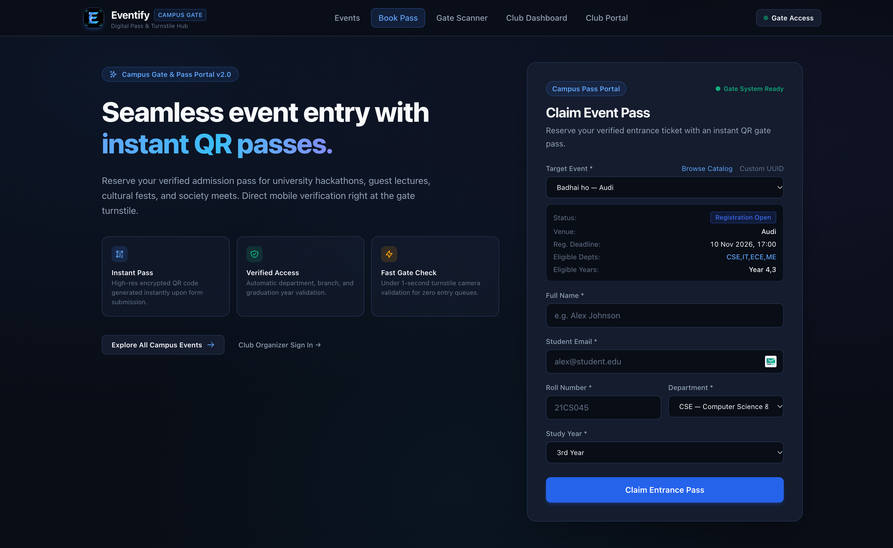
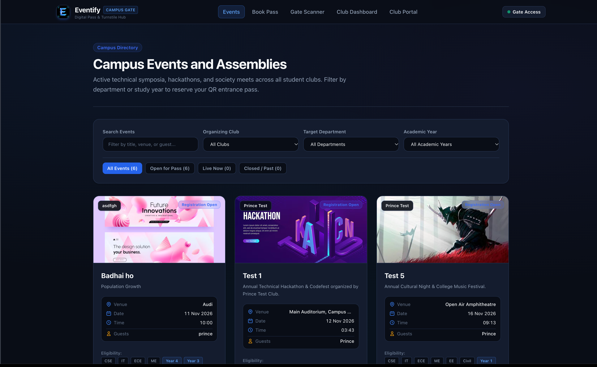
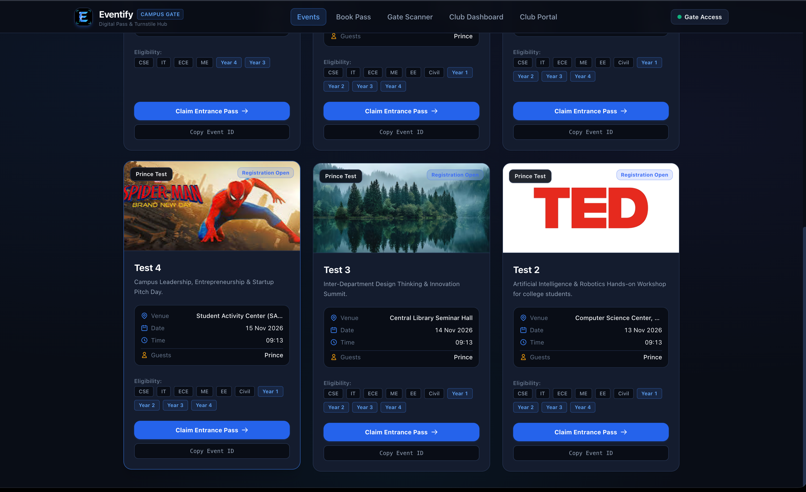
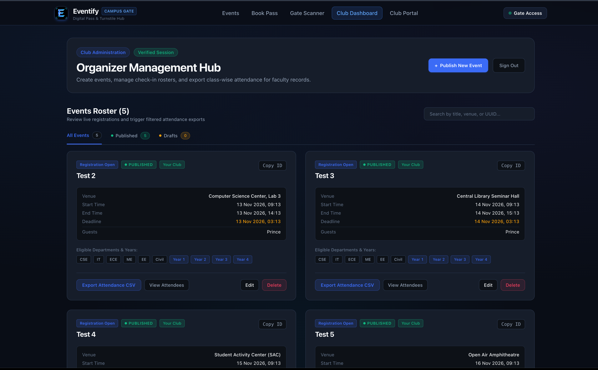
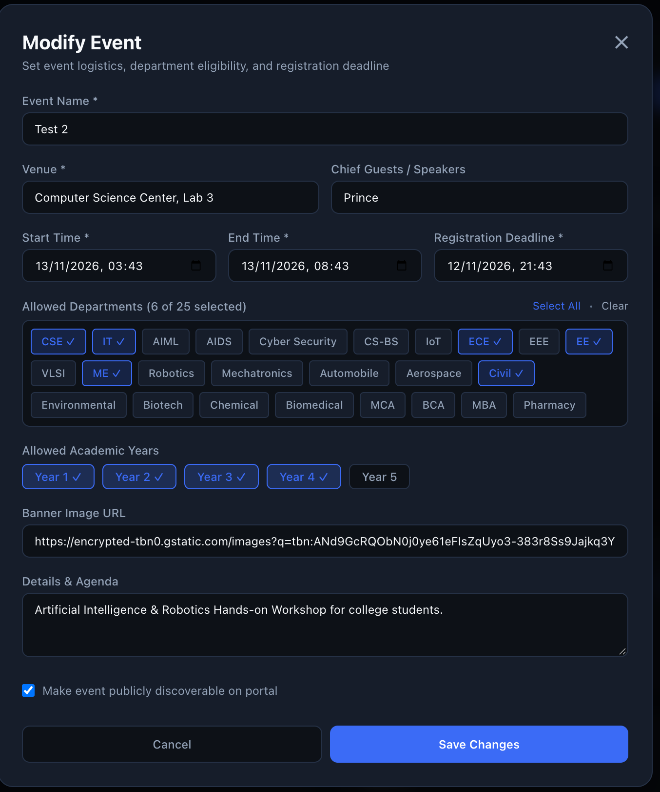
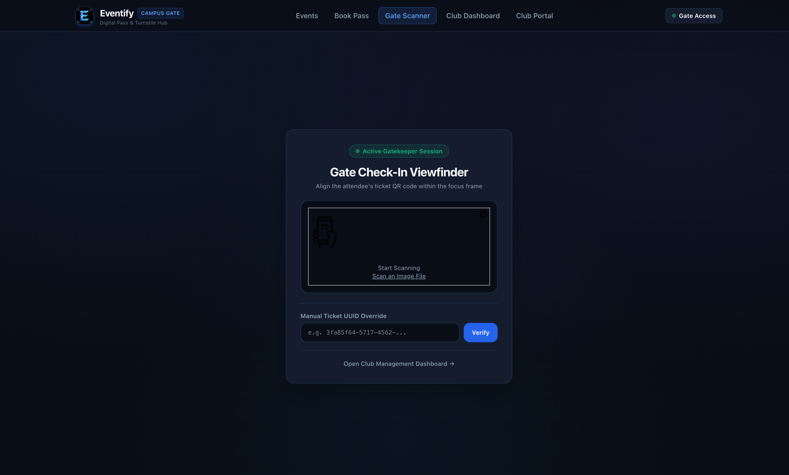
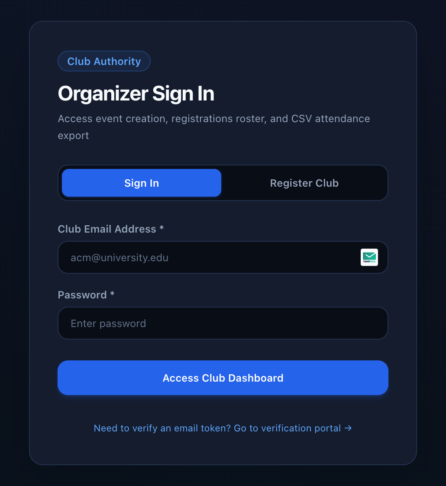

# 🎟️ Eventify — Campus Gate & Digital Pass Hub

<p align="center">
  
</p>

<p align="center">
  <strong>A high-throughput campus event ticketing, turnstile admission, and student club governance platform.</strong>
</p>

<p align="center">
  
  
  
  
  
  
  
</p>

---

## 📌 Overview

**Eventify** modernizes university event logistics. Designed for student clubs, campus assemblies, hackathons, and technical symposia, it replaces slow manual check-in sheets and untracked entries with an encrypted, end-to-end digital pass ecosystem.

Students discover upcoming campus events, verify eligibility by branch and academic year, and reserve high-resolution QR tickets. At the venue gates, club organizers scan passes in real time using turnstile camera scanners and export audit-ready attendance rosters for institutional faculty records.

> 🔗 **Backend Repository:** The complete enterprise Java / Spring Boot 3 REST API for Eventify is available at:  
> 👉 **[https://github.com/Geet-Prince/eventify](https://github.com/Geet-Prince/eventify)**

---

## 📸 Visual Tour & Core Modules

### 1. Student Pass Reservation Portal
Students explore active campus assemblies, inspect venue details, guest speakers, and eligibility criteria, reserving entrance passes with instant encrypted QR codes.

<p align="center">
  
</p>

---

### 2. Live Campus Directory & Event Schedule
Real-time directory featuring live status badges (`Registration Open`, `Live Now`, `Concluded`), multi-attribute filtering (Department, Academic Year, Hosting Club), and one-click pass claiming.

<p align="center">
  
</p>

<p align="center">
  
</p>

---

### 3. Club Organizer Management Hub
Authorized club executives manage their event portfolio, monitor registration counts, toggle draft/published status, inspect attendee rosters, and download institutional CSV attendance sheets.

<p align="center">
  
</p>

---

### 4. Event Creation & Eligibility Configuration
Organizers define event logistics, agendas, and granular academic gate policies across 25+ academic departments and 5 graduation years, choosing whether to publish live or save as an internal draft.

<p align="center">
  
</p>

---

### 5. Camera Turnstile QR Scanner
In-browser optical barcode viewfinder powered by HTML5 camera streams for under-1-second gate validation, with manual UUID override for damaged screens.

<p align="center">
  
</p>

---

### 6. Institutional Club Governance & Authentication
Secure JWT authentication portal with rate-limiting protection, token refresh rotation, and post-registration email token verification.

<p align="center">
  
</p>

---

## ✨ Key Platform Features

| Feature | Description |
|---|---|
| **Encrypted QR Pass Engine** | High-resolution SVG/PNG admission tickets generated client-side upon registration. |
| **Granular Academic Gatekeeper** | Filter attendance by 25+ engineering & science disciplines (CSE, IT, ECE, ME, Civil, etc.) and study years (1st through 5th). |
| **Draft & Published Lifecycle** | Organizers can save events in `Draft` mode (yellow indicator), previewing logistics before one-click publishing (`Published` green indicator). |
| **Real-Time Camera Check-In** | Live video stream turnstile check-in with duplicate scan prevention and audio/visual success indicators. |
| **CSV Attendance Export** | Filter attendee exports by Department, Study Year, and Checked-In status for academic credit and faculty audits. |
| **Token Refresh & Interceptor** | Transparent JWT access token refresh with concurrency mutex, preventing unexpected organizer session expiration. |
| **Hydration-Safe Architecture** | Zero browser extension hydration mismatch errors (`suppressHydrationWarning` on reactive inputs). |

---

## 🛠️ Technology Stack

### Frontend Application (This Repository)
* **Framework:** [Next.js 16](https://nextjs.org/) (App Router, Server & Client Components)
* **UI Library:** [React 19](https://react.dev/)
* **Styling:** [Tailwind CSS 4](https://tailwindcss.com/) with custom Cyber-Gate dark palette
* **Type System:** [TypeScript 5](https://www.typescriptlang.org/)
* **QR & Vision:** `html5-qrcode` & `qrcode.react`
* **Icons & Assets:** Custom vector branding and Lucide UI icons
* **Deployment:** [Vercel](https://vercel.com/) with custom domain DNS routing

### Backend Infrastructure ([Eventify Backend](https://github.com/Geet-Prince/eventify))
* **Runtime:** Java 21 LTS / Spring Boot 3
* **Security:** Spring Security with Stateless JWT Authentication & Refresh Token Rotation
* **Database:** PostgreSQL 17 with HikariCP Connection Pooling & Hibernate ORM
* **Transactional Mail:** Brevo REST API / SMTP Relay with DKIM & DMARC alignment
* **Containerization:** Multi-stage Docker containerization deployed on Render

---

## 🚀 Getting Started

### Prerequisites
* **Node.js:** `v18.18.0` or higher (Node 20+ recommended)
* **Package Manager:** `npm`, `pnpm`, or `yarn`

### 1. Clone the Repository
```bash
git run clone https://github.com/Geet-Prince/eventify-frontend.git
cd eventify-frontend
```

### 2. Configure Environment Variables
Copy the example environment configuration:
```bash
cp .env.example .env.local
```

Configure your backend API base URL:
```env
# Point to your Eventify backend API instance (no trailing slash)
NEXT_PUBLIC_API_URL=https://api.yourdomain.com
NEXT_PUBLIC_API_BASE_URL=https://api.yourdomain.com
```

### 3. Install Dependencies
```bash
npm install
```

### 4. Start Development Server
```bash
npm run dev
```

Open [http://localhost:3000](http://localhost:3000) in your browser.

---

## 📦 Production Build & Deployment

To verify TypeScript types and generate the optimized production bundle:

```bash
# Build production bundle
npm run build

# Start production server
npm start
```

### Deploying to Vercel
1. Import `eventify-frontend` into your Vercel Dashboard.
2. In **Settings > Environment Variables**, add:
   * `NEXT_PUBLIC_API_URL`: Your production backend URL (e.g. `https://api.yourdomain.com`)
   * `NEXT_PUBLIC_API_BASE_URL`: Same as above
3. Deploy!

---

## 📁 Repository Structure

```text
eventify-frontend/
├── app/
│   ├── components/         # Shared navigation bar and layout components
│   ├── constants/          # Campus departments and academic year definitions
│   ├── dashboard/          # Club Organizer Management Hub (Drafts, Published, Exports)
│   ├── events/             # Campus Events & Assemblies directory page
│   ├── login/              # Club executive sign-in & registration portal
│   ├── scanner/            # Camera-based turnstile QR check-in viewfinder
│   ├── services/           # Typed API service clients with credentials & token refresh
│   ├── utils/              # Event lifecycle status and datetime formatters
│   ├── verify/             # Institutional email verification portal
│   ├── globals.css         # Cyber-gate theme definitions & design tokens
│   ├── layout.tsx          # Root HTML shell with responsive viewport settings
│   └── page.tsx            # Digital Pass reservation portal & hero landing page
├── imgs/                   # High-resolution screenshots of core platform modules
├── public/                 # Static assets, vector icons, and favicon files
├── next.config.ts          # Next.js compiler & experimental features config
├── tailwind.config.ts      # Utility-first design tokens and responsive breakpoints
└── tsconfig.json           # Strict TypeScript configuration
```

---

## 🤝 Related Repositories

* **Backend Service (Spring Boot 3 + PostgreSQL):**  
  [https://github.com/Geet-Prince/eventify](https://github.com/Geet-Prince/eventify)

---

## 📄 License

This project is licensed under the [MIT License](LICENSE).
